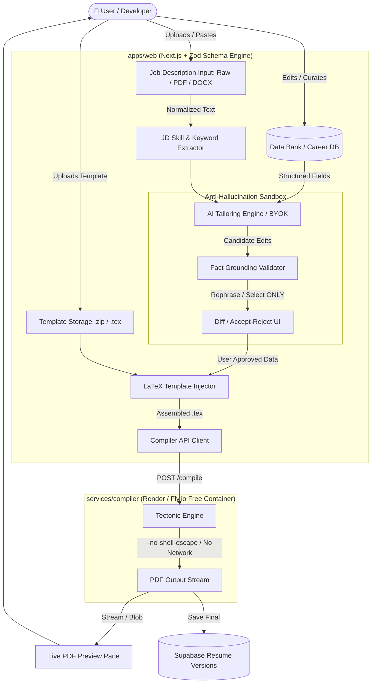
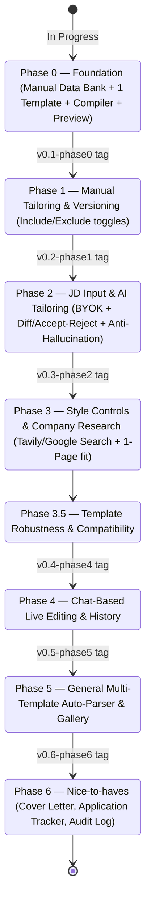

# 🗺️ Project Map & Knowledge Graph — Resume Builder

> **Welcome to the Central Navigation Hub & Map of Content (MOC).**  
> This document maps all subsystems, architecture boundaries, specifications, rules, workflows, and current states. It is built with bidirectional `[[wikilinks]]` for Obsidian graph traversal and structured context recovery for AI agents.

---

## 🧭 Rapid Agent & Developer Navigation (Index)

| Area | Primary Files / Links | Purpose & Authority |
| :--- | :--- | :--- |
| **📜 Project Memory** | [[context.md]] | **Append-only** history, state, decisions, and blockers. |
| **⚖️ Authoritative Rules** | [[rules.md]] | Immutable engineering constraints (**R1**: Phase Independence, **R2**: Phase-Bounded Push). |
| **🎯 Product Spec** | [[product.md]] | Complete product definition, 20 core features, phases 0–6, hosting, and architecture notes. |
| **📋 Immediate Needs** | [[requirements.md]] | User action items blocking the current phase (Phase 0 Supabase, LaTeX template, test data). |
| **🌐 Web Frontend** | [[apps/web/package.json]] · [[apps/web/README.md]] | Next.js App Router (Vercel) — UI, Data Bank forms, diff reviewer, preview pane. |
| **⚙️ Compile Service** | [[services/compiler/package.json]] · [[services/compiler/README.md]] | Sandboxed Dockerized `tectonic` service (Render/Fly) for isolated PDF generation. |
| **📦 Shared Types** | [[packages/shared/package.json]] · [[packages/shared/README.md]] | Single source of truth for Zod schemas, Data Bank entity types, JD schemas. |
| **🏗️ Workspace Config** | [[pnpm-workspace.yaml]] · [[package.json]] | Monorepo layout and package management. |

---

## 🏛️ System Architecture & Data Flow



---

## 🧱 Monorepo Layout & Responsibility Matrix

```
resume-builder/
├── 📄 context.md              # Append-only project log, current state & decisions
├── 📄 rules.md                # Authoritative project rules (R1, R2, invariants)
├── 📄 product.md              # Full product spec (features §2, hosting §3, phases §5)
├── 📄 requirements.md         # Actionable checklist for user inputs (Supabase, template, test data)
├── 📄 PROJECT_MAP.md          # Central Map of Content (this file)
├── 📄 pnpm-workspace.yaml      # Monorepo workspace configuration
├── 📄 package.json            # Root scripts and dev dependencies
├── 📁 apps/
│   └── 📁 web/                # Next.js (App Router) on Vercel
│       ├── 📄 package.json    # @resume-builder/web
│       └── 📄 README.md       # Web frontend overview & landing phase
├── 📁 packages/
│   └── 📁 shared/             # Zod schemas, TypeScript types, constants
│       ├── 📄 package.json    # @resume-builder/shared
│       └── 📄 README.md       # Shared types overview
└── 📁 services/
    └── 📁 compiler/           # Dockerized tectonic compile microservice (Render/Fly)
        ├── 📄 package.json    # @resume-builder/compiler
        └── 📄 README.md       # Compiler service overview
```

### Module Responsibilities:

1. **`apps/web`**
   - User Interface: Data Bank management forms, JD ingestion, Version comparison, Diff acceptance UI, Preview viewer.
   - Server-side routes for BYOK AI orchestration (OpenAI, Anthropic, Gemini, NIM, Ollama).
   - Direct integration with Supabase (DB + Storage).
2. **`services/compiler`**
   - Zero-network isolated microservice running `tectonic`.
   - Accepts `.tex` source and asset bundle, enforces CPU and memory limits, outputs raw PDF or LaTeX logs on error.
3. **`packages/shared`**
   - Contains all canonical Zod schemas: `DataBankSchema`, `JobDescriptionSchema`, `ResumeVersionSchema`, `TemplateMetaSchema`.
   - Guarantees type consistency between frontend and compiler client.

---

## 🚦 Invariants & Non-Negotiable Rules

Before writing any code or proposing architecture changes, verify alignment with [[rules.md]]:

> [!IMPORTANT]
> ### 1. R1 — Phase Independence
> - Every phase must stand on its own feet. Phase $N$ **cannot** depend on unfinished or broken state of Phase $N-1$.
> - Rollback safety: Merging Phase $N$ must never break prior verified phase goals.
> 
> ### 2. R2 — Phase-Bounded Push
> - Only push to `origin/main` when a phase is **completely running** and its goal (§5 of [[product.md]]) is fully verified on a fresh checkout.
> - WIP work stays on local feature branches (`phase-0-foundation`, etc.).
> 
> ### 3. Anti-Hallucination Invariant
> - **AI never edits raw LaTeX directly.** AI only selects, reorders, or rephrases fields inside the structured Data Bank representation.
> - Any number or metric not in the source Data Bank requires explicit user confirmation.
> 
> ### 4. Sandboxed Compilation
> - LaTeX compilation must always run with `--no-shell-escape` and no network access.

---

## 🗺️ Phase Roadmap & Lifecycle Tracker



### Current Status:
- **Active Phase**: `Phase 0 — Foundation`
- **Current Blockers / Inputs Needed** (Tracked in [[requirements.md]]):
  1. Supabase Project credentials (`R0.1`)
  2. One LaTeX template `.zip` or authorization for Jake's Resume (`R0.2`)
  3. Sample Data Bank content (`R0.3`)

---

## 🤖 Agent Operating Protocol (How to Travel This Repo)

When an AI agent initializes or receives a prompt on this codebase:

```mermaid
flowchart TD
    Start([🚀 Agent Starts Task]) --> ReadRules[1. Read [[rules.md]] for Constraints]
    ReadRules --> ReadContext[2. Read [[context.md]] for Current State & Decision Log]
    ReadContext --> CheckBlockers{Are there open blockers in [[requirements.md]]?}
    CheckBlockers -->|Yes| PromptUser[Surface specific blocker to user]
    CheckBlockers -->|No| WorkOnBranch[3. Work strictly on active phase branch]
    WorkOnBranch --> VerifyGoal[4. Verify against Phase Goal in [[product.md]]]
    VerifyGoal --> AppendLog[5. Append decisions/state changes to [[context.md]]]
```

### Agent Context Recovery Checklist:
1. **Never rewrite [[context.md]] history**: Only append to the bottom; update `## State` explicitly when state transitions happen.
2. **Never push half-baked phases to `main`**: Adhere strictly to **R2**.
3. **Verify Zod types in `packages/shared`**: Always define schemas before implementing UI forms or DB tables.
4. **Link references using Obsidian wikilinks**: Connect artifacts with `[[file.md]]` syntax.

---

## 🔗 Obsidian Knowledge Graph Connections

- Root Hub: [[PROJECT_MAP.md]]
- Core Specs: [[product.md]] · [[requirements.md]]
- Governance: [[rules.md]] · [[context.md]]
- Monorepo Nodes:
  - [[apps/web/package.json]]
  - [[services/compiler/package.json]]
  - [[packages/shared/package.json]]
- Remote Repositories:
  - GitHub: [Vishal-Autade185/resume-builder](https://github.com/Vishal-Autade185/resume-builder)
